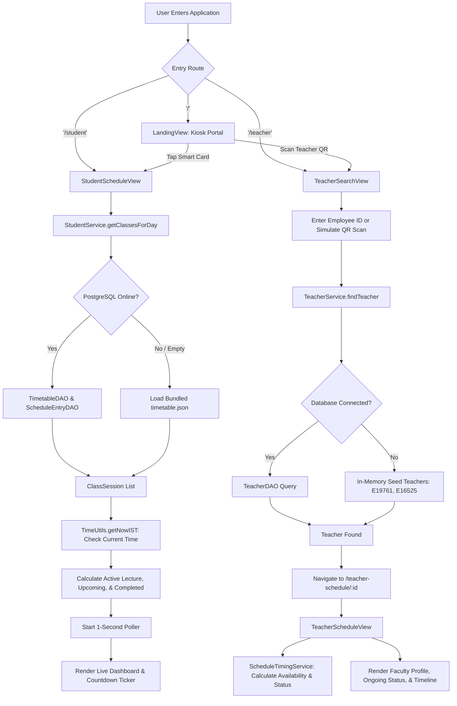

# CU Daily Schedule — Comprehensive Architecture & Workflow Guide

> **System**: Chandigarh University Smart Timetable Kiosk & Web Portal  
> **Core Stack**: Java 21 LTS · Spring Boot 3.3.5 · Vaadin Flow 24.4.20 · PostgreSQL (Supabase) · JDBC · Jackson · FlatLaf Swing  
> **Last Updated**: October 2026  

---

## Table of Contents
1. [Project Overview & System Purpose](#1-project-overview--system-purpose)
2. [Technology Stack: What We Use & Why](#2-technology-stack-what-we-use--why)
3. [System Architecture & Layering](#3-system-architecture--layering)
4. [File-by-File Connection Directory & Dependency Matrix](#4-file-by-file-connection-directory--dependency-matrix)
5. [End-to-End System Workflows](#5-end-to-end-system-workflows)
   - [Workflow 1: Bootstrapping & Database Initialization](#workflow-1-bootstrapping--database-initialization)
   - [Workflow 2: Student Schedule Workflow (Desktop & Mobile)](#workflow-2-student-schedule-workflow-desktop--mobile)
   - [Workflow 3: Teacher Search & Live Schedule Tracking](#workflow-3-teacher-search--live-schedule-tracking)
   - [Workflow 4: Admin CRUD Management & Diagnostics](#workflow-4-admin-crud-management--diagnostics)
   - [Workflow 5: High-Resilience Offline Fallback Pipeline](#workflow-5-high-resilience-offline-fallback-pipeline)
   - [Workflow 6: Responsive Mobile Layout & Reordering](#workflow-6-responsive-mobile-layout--reordering)
6. [Database Schema & Data Model](#6-database-schema--data-model)
7. [Component & Styling Architecture](#7-component--styling-architecture)
8. [Summary & Quick Reference](#8-summary--quick-reference)

---

## 1. Project Overview & System Purpose

The **CU Daily Schedule** is an enterprise-grade university timetable and faculty tracking platform designed for **Chandigarh University (CU)**. It addresses several critical campus operational needs:

1. **Student Kiosk Dashboard**: Allows students to quickly view their current class, countdown to lecture completion, remaining classes for the day, and tomorrow's upcoming schedule.
2. **Faculty Locator & Availability Tracker**: Allows students and administrators to search for faculty members by Employee ID or QR code to find their current location (Block, Room, Floor), whether they are currently lecturing, and their complete weekly routine.
3. **Smart Kiosk Simulation**: Operates both as a responsive web application accessible on phones/laptops and as a physical campus kiosk supporting simulated NFC smart card tap and QR code scanning.
4. **Resilient Data Architecture**: Features direct cloud database connectivity to Supabase PostgreSQL over JDBC, with automatic in-memory and JSON fallbacks so that kiosk terminals continue functioning without downtime during campus network outages.

---

## 2. Technology Stack: What We Use & Why

The table below explains every single component of the technology stack, what it does in the project, and the specific engineering rationale for choosing it:

| Technology | Version / Tool | Used For | Why We Chose It (Engineering Rationale) |
|---|---|---|---|
| **Programming Language** | **Java 21 LTS** | Core application logic, data modeling, backend services, and web UI definitions | - **Long Term Support (LTS)**: Guarantees enterprise stability and security patches.<br>- **Pattern Matching & Modern Syntax**: Cleaner record-like models, enhanced switch expressions, and robust type safety.<br>- **High Performance**: JVM garbage collection and JIT compiler handle concurrent kiosk requests with sub-millisecond latencies. |
| **Backend Framework** | **Spring Boot** (`3.3.5`) | Application lifecycle, dependency injection (DI), configuration management, embedded web server | - **Embedded Tomcat 10**: Bundles an enterprise web server directly in the JAR—no need for external web server installations.<br>- **Dependency Injection**: Decouples services (`@Service`) from UI controllers, simplifying unit testing and mocking.<br>- **Microservice Ready**: Easily integrates production telemetry, environment property resolution, and deployment pipelines. |
| **Web UI Framework** | **Vaadin Flow** (`24.4.20`) | Web frontend, dynamic UI components, client-server reactivity | - **Pure Java UI**: UI components (buttons, grids, layouts) are instantiated as Java objects on the server. Zero JavaScript/TypeScript boilerplate required.<br>- **Zero Credential Exposure**: Because UI state and data logic execute strictly on the server JVM, database credentials, connection URLs, and sensitive queries never touch the client browser.<br>- **WebSocket Push (`@Push`)**: Bidirectional real-time updates over WebSockets for live clocks, active session highlights, and countdown timers without full page refreshes.<br>- **Responsive Design**: Automatically handles screen breakpoints, flex layouts, and mobile adaptations. |
| **Database** | **PostgreSQL** (Supabase) | Primary relational cloud datastore | - **ACID Compliance**: Ensures strict transactional consistency for timetable schedules and teacher assignments.<br>- **Relational Integrity**: Foreign key constraints (`ON DELETE CASCADE`, `ON DELETE SET NULL`) guarantee referential safety across tables.<br>- **PL/pgSQL Triggers**: Auto-updates `updated_at` timestamps using database-level functions (`update_modified_column`).<br>- **Cloud Scalability**: Hosted on Supabase with PgBouncer connection pooling on port 6543 with SSL encryption. |
| **Database Connectivity** | **JDBC** (`postgresql-42.7.3`) | Direct communication between Java services and PostgreSQL | - **Lightweight & Fast**: Direct JDBC executes parameterized SQL with near-zero overhead compared to heavy ORMs like Hibernate/JPA.<br>- **Explicit Control**: Direct access to `PreparedStatement`, `ResultSet`, and connection management prevents unexpected N+1 queries or lazy-initialization exceptions.<br>- **SQL Injection Immunity**: All queries use parameterized placeholders (`?`), neutralizing malicious input.<br>- **Rapid Diagnostic Testing**: Enables millisecond-level connection checks via `SELECT 1` queries. |
| **JSON Serialization** | **Jackson Databind** (`2.17.2`) | Reading and parsing bundled fallback timetables | - **Instant Offline Fallback**: Parses the bundled `timetable.json` resource into Java `ClassSession` objects when the remote database is unreachable.<br>- **Type-Safe Mapping**: Converts JSON arrays directly into Java collections using `TypeReference<List<ClassSession>>()`. |
| **Desktop UI Engine** | **Java Swing** + **FlatLaf** (`3.5.4`) | Legacy standalone kiosk & offline desktop execution | - **Dual-Target Flexibility**: Preserved in `com.cudailyschedule.ui` to allow the software to run directly on physical desktop computers or air-gapped kiosk machines without a web browser.<br>- **FlatLaf Styling**: Modern clean look-and-feel with macOS/Windows-style rounded borders, high-DPI scaling, and smooth anti-aliased font rendering. |
| **Build Automation** | **Apache Maven** (`3.9+`) | Build lifecycle, dependency resolution, packaging | - **Standardized Lifecycle**: Automates compilation, testing, frontend asset preparation via `vaadin-maven-plugin`, and executable fat-JAR assembly via `spring-boot-maven-plugin`. |
| **Deployment & Containers** | **Docker** & **Render** | Containerization and cloud hosting | - **Reproducible Builds**: Multi-stage `Dockerfile` (Eclipse Temurin JDK 21 base) packages the application for cloud deployment without platform discrepancies. |

---

## 3. System Architecture & Layering

The application follows a **Clean Layered Architecture**. The core domain, persistence, and business logic are shared across both the modern **Vaadin Web Engine** and the **Swing Desktop Engine**:

```
+-----------------------------------------------------------------------------------+
|                                PRESENTATION LAYER                                 |
|                                                                                   |
|   +---------------------------------------+   +-------------------------------+   |
|   |         Vaadin Flow Web Layer         |   |      Swing Desktop Layer      |   |
|   |        (com.cudailyschedule.web)      |   |    (com.cudailyschedule.ui)   |   |
|   |                                       |   |                               |   |
|   |  - LandingView (/)                    |   |  - MainFrame (CardLayout)     |   |
|   |  - StudentScheduleView (/student)     |   |  - LandingScreen              |   |
|   |  - TeacherSearchView (/teacher)       |   |  - StudentScheduleScreen      |   |
|   |  - TeacherScheduleView (/teacher-...) |   |  - TeacherSearchScreen        |   |
|   |  - AdminScheduleDialog (Modal)        |   |  - TeacherScheduleScreen      |   |
|   |  - FloatingSettingsButton             |   |  - AdminScheduleDialog        |   |
|   +-------------------+-------------------+   +---------------+---------------+   |
+-----------------------|---------------------------------------|-------------------+
                        |                                       |
                        +-------------------+-------------------+
                                            |
                                            v
+-----------------------------------------------------------------------------------+
|                                  SERVICE LAYER                                    |
|                            (com.cudailyschedule.service)                          |
|                                                                                   |
|   - StudentService: Day queries, DB loading, bundled timetable.json fallback      |
|   - TeacherService: Teacher lookup, schedule entries, seed data fallback          |
|   - ScheduleTimingService: IST time math, active/next class status, countdowns    |
|   - AdminScheduleService: Validation, CRUD business logic for timetables/slots    |
|   - DatabaseService: Connection health checking, response time diagnostics        |
+-------------------------------------------+---------------------------------------+
                                            |
                                            v
+-----------------------------------------------------------------------------------+
|                             DATA ACCESS OBJECTS (DAO)                             |
|                              (com.cudailyschedule.dao)                            |
|                                                                                   |
|   - TimetableDAO: CRUD for 'timetables' table                                     |
|   - TeacherDAO: Query & insert for 'teachers' table                               |
|   - StudentDAO: Query & insert for 'students' table                               |
|   - ScheduleEntryDAO: Query, insert, update, delete for 'schedule_entries'        |
+-------------------------------------------+---------------------------------------+
                                            |
                                            v
+-----------------------------------------------------------------------------------+
|                           CONFIGURATION & CONNECTIVITY                            |
|                            (com.cudailyschedule.config)                           |
|                                                                                   |
|   - DBConfig: Reads .env, system env, config.properties, builds JDBC URL          |
|   - DBConnection: Thread-safe connection factory, SELECT 1 diagnostic tester      |
+-------------------------------------------+---------------------------------------+
                                            |
                     +----------------------+----------------------+
                     |                                             |
                     v                                             v
        +-------------------------+                   +-------------------------+
        |  PostgreSQL / Supabase  |                   |  Local Fallback Files   |
        |  (Cloud Cloud Relational|                   |  (timetable.json,       |
        |   Database with SSL)    |                   |   in-memory seed maps)  |
        +-------------------------+                   +-------------------------+
```

---

## 4. File-by-File Connection Directory & Dependency Matrix

Every file in the repository has a dedicated role and interacts directly with other specific classes. Below is the complete directory of every file in the project:

### 4.1 Application Entry Points

| File Path | Package | Primary Responsibility | Connects With / Invokes |
|---|---|---|---|
| [`Application.java`](file:///c:/Workspace/Active%20projects/cu_daily_schedule%20_java/cu-daily-schedule-java/src/main/java/com/cudailyschedule/Application.java) | `com.cudailyschedule` | Spring Boot main entry point for the web application. Configures `@Push` and theme `cu-daily-schedule`. | - Launches Spring Boot runtime (`SpringApplication.run`).<br>- Registers Vaadin views in `com.cudailyschedule.web`. |
| [`Main.java`](file:///c:/Workspace/Active%20projects/cu_daily_schedule%20_java/cu-daily-schedule-java/src/main/java/com/cudailyschedule/Main.java) | `com.cudailyschedule` | Standalone desktop launcher for Swing kiosk mode. Initializes FlatLaf and tests DB connection in a background thread. | - Calls [`FlatLightLaf.setup()`](file:///c:/Workspace/Active%20projects/cu_daily_schedule%20_java/cu-daily-schedule-java/pom.xml#L62-L66).<br>- Invokes [`DatabaseService.checkConnection()`](file:///c:/Workspace/Active%20projects/cu_daily_schedule%20_java/cu-daily-schedule-java/src/main/java/com/cudailyschedule/service/DatabaseService.java).<br>- Instantiates [`MainFrame`](file:///c:/Workspace/Active%20projects/cu_daily_schedule%20_java/cu-daily-schedule-java/src/main/java/com/cudailyschedule/ui/MainFrame.java) on the Swing EDT. |

---

### 4.2 Configuration Layer (`com.cudailyschedule.config`)

| File Path | Primary Responsibility | Connects With / Invokes |
|---|---|---|
| [`DBConfig.java`](file:///c:/Workspace/Active%20projects/cu_daily_schedule%20_java/cu-daily-schedule-java/src/main/java/com/cudailyschedule/config/DBConfig.java) | Singleton configuration manager. Discovers and loads database settings with strict priority: System Environment Variables > `.env` / `.env.local` files > `config.properties` > Defaults. | - Scans `.env` files in root and child directories.<br>- Generates formatted JDBC URL with SSL settings (`sslmode=require`) and connection timeouts.<br>- Used directly by [`DBConnection`](file:///c:/Workspace/Active%20projects/cu_daily_schedule%20_java/cu-daily-schedule-java/src/main/java/com/cudailyschedule/config/DBConnection.java). |
| [`DBConnection.java`](file:///c:/Workspace/Active%20projects/cu_daily_schedule%20_java/cu-daily-schedule-java/src/main/java/com/cudailyschedule/config/DBConnection.java) | Factory for thread-safe JDBC connections. Implements connection diagnostics (`testConnection`) via `SELECT 1`. | - Loads `org.postgresql.Driver`.<br>- Calls [`DBConfig.getInstance()`](file:///c:/Workspace/Active%20projects/cu_daily_schedule%20_java/cu-daily-schedule-java/src/main/java/com/cudailyschedule/config/DBConfig.java) to obtain JDBC credentials.<br>- Invoked by all DAOs ([`TimetableDAO`](file:///c:/Workspace/Active%20projects/cu_daily_schedule%20_java/cu-daily-schedule-java/src/main/java/com/cudailyschedule/dao/TimetableDAO.java), [`TeacherDAO`](file:///c:/Workspace/Active%20projects/cu_daily_schedule%20_java/cu-daily-schedule-java/src/main/java/com/cudailyschedule/dao/TeacherDAO.java), [`StudentDAO`](file:///c:/Workspace/Active%20projects/cu_daily_schedule%20_java/cu-daily-schedule-java/src/main/java/com/cudailyschedule/dao/StudentDAO.java), [`ScheduleEntryDAO`](file:///c:/Workspace/Active%20projects/cu_daily_schedule%20_java/cu-daily-schedule-java/src/main/java/com/cudailyschedule/dao/ScheduleEntryDAO.java)) and [`DatabaseService`](file:///c:/Workspace/Active%20projects/cu_daily_schedule%20_java/cu-daily-schedule-java/src/main/java/com/cudailyschedule/service/DatabaseService.java). |

---

### 4.3 Domain Models (`com.cudailyschedule.model`)

| File Path | Entity Represented | Fields & Role | Used By |
|---|---|---|---|
| [`Timetable.java`](file:///c:/Workspace/Active%20projects/cu_daily_schedule%20_java/cu-daily-schedule-java/src/main/java/com/cudailyschedule/model/Timetable.java) | `timetables` table | `id` (UUID), `timetableName`, `timetableType` ("student" or "teacher"), `createdAt`, `updatedAt`. | [`TimetableDAO`](file:///c:/Workspace/Active%20projects/cu_daily_schedule%20_java/cu-daily-schedule-java/src/main/java/com/cudailyschedule/dao/TimetableDAO.java), [`StudentService`](file:///c:/Workspace/Active%20projects/cu_daily_schedule%20_java/cu-daily-schedule-java/src/main/java/com/cudailyschedule/service/StudentService.java), [`AdminScheduleService`](file:///c:/Workspace/Active%20projects/cu_daily_schedule%20_java/cu-daily-schedule-java/src/main/java/com/cudailyschedule/service/AdminScheduleService.java). |
| [`Teacher.java`](file:///c:/Workspace/Active%20projects/cu_daily_schedule%20_java/cu-daily-schedule-java/src/main/java/com/cudailyschedule/model/Teacher.java) | `teachers` table | `id`, `employeeId` (e.g. "E19761"), `employeeName`, `department`, `timetableId`. | [`TeacherDAO`](file:///c:/Workspace/Active%20projects/cu_daily_schedule%20_java/cu-daily-schedule-java/src/main/java/com/cudailyschedule/dao/TeacherDAO.java), [`TeacherService`](file:///c:/Workspace/Active%20projects/cu_daily_schedule%20_java/cu-daily-schedule-java/src/main/java/com/cudailyschedule/service/TeacherService.java), [`TeacherSearchView`](file:///c:/Workspace/Active%20projects/cu_daily_schedule%20_java/cu-daily-schedule-java/src/main/java/com/cudailyschedule/web/TeacherSearchView.java), [`TeacherScheduleView`](file:///c:/Workspace/Active%20projects/cu_daily_schedule%20_java/cu-daily-schedule-java/src/main/java/com/cudailyschedule/web/TeacherScheduleView.java). |
| [`Student.java`](file:///c:/Workspace/Active%20projects/cu_daily_schedule%20_java/cu-daily-schedule-java/src/main/java/com/cudailyschedule/model/Student.java) | `students` table | `id`, `studentUid`, `studentName`, `timetableId`. | [`StudentDAO`](file:///c:/Workspace/Active%20projects/cu_daily_schedule%20_java/cu-daily-schedule-java/src/main/java/com/cudailyschedule/dao/StudentDAO.java). |
| [`ScheduleEntry.java`](file:///c:/Workspace/Active%20projects/cu_daily_schedule%20_java/cu-daily-schedule-java/src/main/java/com/cudailyschedule/model/ScheduleEntry.java) | `schedule_entries` table | `id`, `timetableId`, `dayOfWeek`, `courseName`, `courseCode`, `startTime`, `endTime`, `section`, `courseType`, `studentGroup`, `blockNo`, `roomNo`, `partition`. | [`ScheduleEntryDAO`](file:///c:/Workspace/Active%20projects/cu_daily_schedule%20_java/cu-daily-schedule-java/src/main/java/com/cudailyschedule/dao/ScheduleEntryDAO.java), [`TeacherService`](file:///c:/Workspace/Active%20projects/cu_daily_schedule%20_java/cu-daily-schedule-java/src/main/java/com/cudailyschedule/service/TeacherService.java), [`ScheduleTimingService`](file:///c:/Workspace/Active%20projects/cu_daily_schedule%20_java/cu-daily-schedule-java/src/main/java/com/cudailyschedule/service/ScheduleTimingService.java), [`AdminScheduleDialog`](file:///c:/Workspace/Active%20projects/cu_daily_schedule%20_java/cu-daily-schedule-java/src/main/java/com/cudailyschedule/web/AdminScheduleDialog.java). |
| [`ClassSession.java`](file:///c:/Workspace/Active%20projects/cu_daily_schedule%20_java/cu-daily-schedule-java/src/main/java/com/cudailyschedule/model/ClassSession.java) | Student lecture model | Models the student timetable schema: `day`, `period`, `subject`, `subjectCode`, `teacher`, `room`, `block`, `type`, `group`, `startTime`, `endTime`. Supports JSON deserialization. | [`StudentService`](file:///c:/Workspace/Active%20projects/cu_daily_schedule%20_java/cu-daily-schedule-java/src/main/java/com/cudailyschedule/service/StudentService.java), [`StudentScheduleView`](file:///c:/Workspace/Active%20projects/cu_daily_schedule%20_java/cu-daily-schedule-java/src/main/java/com/cudailyschedule/web/StudentScheduleView.java). |
| [`ScheduleStatus.java`](file:///c:/Workspace/Active%20projects/cu_daily_schedule%20_java/cu-daily-schedule-java/src/main/java/com/cudailyschedule/model/ScheduleStatus.java) | Real-time status state | Enumerates status (`BEFORE`, `ONGOING`, `AFTER`, `FREE`, `WEEKEND`), holding references to current class, next class, and remaining seconds. | [`ScheduleTimingService`](file:///c:/Workspace/Active%20projects/cu_daily_schedule%20_java/cu-daily-schedule-java/src/main/java/com/cudailyschedule/service/ScheduleTimingService.java), [`TeacherScheduleView`](file:///c:/Workspace/Active%20projects/cu_daily_schedule%20_java/cu-daily-schedule-java/src/main/java/com/cudailyschedule/web/TeacherScheduleView.java). |

---

### 4.4 Data Access Layer (`com.cudailyschedule.dao`)

| File Path | Target Database Table | Key Methods & Operations | Invoked By |
|---|---|---|---|
| [`TimetableDAO.java`](file:///c:/Workspace/Active%20projects/cu_daily_schedule%20_java/cu-daily-schedule-java/src/main/java/com/cudailyschedule/dao/TimetableDAO.java) | `timetables` | `findById(UUID)`, `findByType(String)`, `findAll()`, `save(Timetable)`, `delete(UUID)`. | [`StudentService`](file:///c:/Workspace/Active%20projects/cu_daily_schedule%20_java/cu-daily-schedule-java/src/main/java/com/cudailyschedule/service/StudentService.java), [`AdminScheduleService`](file:///c:/Workspace/Active%20projects/cu_daily_schedule%20_java/cu-daily-schedule-java/src/main/java/com/cudailyschedule/service/AdminScheduleService.java). |
| [`TeacherDAO.java`](file:///c:/Workspace/Active%20projects/cu_daily_schedule%20_java/cu-daily-schedule-java/src/main/java/com/cudailyschedule/dao/TeacherDAO.java) | `teachers` | `findByEmployeeId(String)`, `findAll()`, `save(Teacher)`, `delete(UUID)`. | [`TeacherService`](file:///c:/Workspace/Active%20projects/cu_daily_schedule%20_java/cu-daily-schedule-java/src/main/java/com/cudailyschedule/service/TeacherService.java), [`AdminScheduleService`](file:///c:/Workspace/Active%20projects/cu_daily_schedule%20_java/cu-daily-schedule-java/src/main/java/com/cudailyschedule/service/AdminScheduleService.java). |
| [`StudentDAO.java`](file:///c:/Workspace/Active%20projects/cu_daily_schedule%20_java/cu-daily-schedule-java/src/main/java/com/cudailyschedule/dao/StudentDAO.java) | `students` | `findByStudentUid(String)`, `findAll()`, `save(Student)`, `delete(UUID)`. | Academic model completeness & student profile lookups. |
| [`ScheduleEntryDAO.java`](file:///c:/Workspace/Active%20projects/cu_daily_schedule%20_java/cu-daily-schedule-java/src/main/java/com/cudailyschedule/dao/ScheduleEntryDAO.java) | `schedule_entries` | `findByTimetableId(UUID)`, `findByTimetableIdAndDay(UUID, String)`, `save(ScheduleEntry)`, `delete(UUID)`. | [`StudentService`](file:///c:/Workspace/Active%20projects/cu_daily_schedule%20_java/cu-daily-schedule-java/src/main/java/com/cudailyschedule/service/StudentService.java), [`TeacherService`](file:///c:/Workspace/Active%20projects/cu_daily_schedule%20_java/cu-daily-schedule-java/src/main/java/com/cudailyschedule/service/TeacherService.java), [`AdminScheduleService`](file:///c:/Workspace/Active%20projects/cu_daily_schedule%20_java/cu-daily-schedule-java/src/main/java/com/cudailyschedule/service/AdminScheduleService.java). |

---

### 4.5 Business Service Layer (`com.cudailyschedule.service`)

| File Path | Spring Annotation | Key Business Responsibilities | Connected Components |
|---|---|---|---|
| [`StudentService.java`](file:///c:/Workspace/Active%20projects/cu_daily_schedule%20_java/cu-daily-schedule-java/src/main/java/com/cudailyschedule/service/StudentService.java) | `@Service` | - Retrieves classes for a given day (e.g. "Monday").<br>- Queries PostgreSQL first via [`TimetableDAO`](file:///c:/Workspace/Active%20projects/cu_daily_schedule%20_java/cu-daily-schedule-java/src/main/java/com/cudailyschedule/dao/TimetableDAO.java) and [`ScheduleEntryDAO`](file:///c:/Workspace/Active%20projects/cu_daily_schedule%20_java/cu-daily-schedule-java/src/main/java/com/cudailyschedule/dao/ScheduleEntryDAO.java).<br>- If database is unreachable or empty, automatically loads and parses `timetable.json` from classpath.<br>- Enriches course codes with names using [`SubjectRegistry`](file:///c:/Workspace/Active%20projects/cu_daily_schedule%20_java/cu-daily-schedule-java/src/main/java/com/cudailyschedule/util/SubjectRegistry.java). | Injected into [`StudentScheduleView`](file:///c:/Workspace/Active%20projects/cu_daily_schedule%20_java/cu-daily-schedule-java/src/main/java/com/cudailyschedule/web/StudentScheduleView.java). |
| [`TeacherService.java`](file:///c:/Workspace/Active%20projects/cu_daily_schedule%20_java/cu-daily-schedule-java/src/main/java/com/cudailyschedule/service/TeacherService.java) | `@Service` | - Finds teachers by Employee ID.<br>- Retrieves complete schedules or day-specific entries.<br>- Integrates pre-seeded fallback data for faculty (Neeraj `E19761`, Gitanjali `E16525`, Jaspreet `E10279`) when database is offline. | Injected into [`TeacherSearchView`](file:///c:/Workspace/Active%20projects/cu_daily_schedule%20_java/cu-daily-schedule-java/src/main/java/com/cudailyschedule/web/TeacherSearchView.java) and [`TeacherScheduleView`](file:///c:/Workspace/Active%20projects/cu_daily_schedule%20_java/cu-daily-schedule-java/src/main/java/com/cudailyschedule/web/TeacherScheduleView.java). |
| [`ScheduleTimingService.java`](file:///c:/Workspace/Active%20projects/cu_daily_schedule%20_java/cu-daily-schedule-java/src/main/java/com/cudailyschedule/service/ScheduleTimingService.java) | `@Service` | - Calculates chronological class state: `NORMAL`, `ACTIVE`, `NEXT`, `COMPLETED`.<br>- Computes remaining seconds to lecture finish or next lecture arrival in Indian Standard Time (`Asia/Kolkata`). | Used by [`TeacherScheduleView`](file:///c:/Workspace/Active%20projects/cu_daily_schedule%20_java/cu-daily-schedule-java/src/main/java/com/cudailyschedule/web/TeacherScheduleView.java) and timing test suites. |
| [`AdminScheduleService.java`](file:///c:/Workspace/Active%20projects/cu_daily_schedule%20_java/cu-daily-schedule-java/src/main/java/com/cudailyschedule/service/AdminScheduleService.java) | `@Service` | - Enforces validation rules (valid day name, 12h AM/PM time syntax, non-null timetable ID).<br>- Performs transactional CRUD on timetable entries. | Used by [`AdminScheduleDialog`](file:///c:/Workspace/Active%20projects/cu_daily_schedule%20_java/cu-daily-schedule-java/src/main/java/com/cudailyschedule/web/AdminScheduleDialog.java). |
| [`DatabaseService.java`](file:///c:/Workspace/Active%20projects/cu_daily_schedule%20_java/cu-daily-schedule-java/src/main/java/com/cudailyschedule/service/DatabaseService.java) | `@Service` | - Caches and provides database connection health status.<br>- Tests connection via `DBConnection.testConnection()` and reports roundtrip latency in milliseconds. | Invoked by [`MainLayout`](file:///c:/Workspace/Active%20projects/cu_daily_schedule%20_java/cu-daily-schedule-java/src/main/java/com/cudailyschedule/web/MainLayout.java), [`StudentScheduleView`](file:///c:/Workspace/Active%20projects/cu_daily_schedule%20_java/cu-daily-schedule-java/src/main/java/com/cudailyschedule/web/StudentScheduleView.java), and [`AdminScheduleDialog`](file:///c:/Workspace/Active%20projects/cu_daily_schedule%20_java/cu-daily-schedule-java/src/main/java/com/cudailyschedule/web/AdminScheduleDialog.java). |

---

### 4.6 Utilities (`com.cudailyschedule.util`)

| File Path | Key Functions & Responsibilities | Used By |
|---|---|---|
| [`TimeUtils.java`](file:///c:/Workspace/Active%20projects/cu_daily_schedule%20_java/cu-daily-schedule-java/src/main/java/com/cudailyschedule/util/TimeUtils.java) | - `parseTime("09:30 AM")` -> `LocalTime(09, 30)`.<br>- `formatTime(LocalTime)` -> 12-hour AM/PM string.<br>- `getNowIST()` -> `ZonedDateTime` in `Asia/Kolkata`.<br>- `formatCountdown(long seconds)` -> `"12m 34s"` or `"34s"`. | Used across all views and services for consistent, timezone-accurate IST calculations. |
| [`SubjectRegistry.java`](file:///c:/Workspace/Active%20projects/cu_daily_schedule%20_java/cu-daily-schedule-java/src/main/java/com/cudailyschedule/util/SubjectRegistry.java) | Mapping dictionary converting course codes (e.g. `24CSP-305`, `26CSH-101`) to human-readable academic course names (e.g. "Competitive Coding-II", "Logical Thinking and Problem Solving"). | [`StudentService`](file:///c:/Workspace/Active%20projects/cu_daily_schedule%20_java/cu-daily-schedule-java/src/main/java/com/cudailyschedule/service/StudentService.java) and UI renderers. |
| [`ImageUtils.java`](file:///c:/Workspace/Active%20projects/cu_daily_schedule%20_java/cu-daily-schedule-java/src/main/java/com/cudailyschedule/util/ImageUtils.java) | Swing-specific image scaling and icon caching helper. | Swing UI components in `com.cudailyschedule.ui`. |

---

### 4.7 Web Layer (`com.cudailyschedule.web`)

| File Path | Vaadin Route | UI Role & Functionality | Interacting Classes |
|---|---|---|---|
| [`LandingView.java`](file:///c:/Workspace/Active%20projects/cu_daily_schedule%20_java/cu-daily-schedule-java/src/main/java/com/cudailyschedule/web/LandingView.java) | `@Route("")` | Kiosk Landing Screen. Displays Chandigarh University branding, campus background, and two large interactive cards ("Tap Your Smart Card" -> `/student` and "Scan Teacher QR Code" -> `/teacher`). | Navigates to `student` and `teacher` routes via `UI.getCurrent().navigate(...)`. |
| [`StudentScheduleView.java`](file:///c:/Workspace/Active%20projects/cu_daily_schedule%20_java/cu-daily-schedule-java/src/main/java/com/cudailyschedule/web/StudentScheduleView.java) | `@Route("student")` | Redesigned Student Dashboard. Renders live date, 1-second IST ticking clock, online/offline database status badge, "View Tomorrow" toggle, lecture count overview, dynamic "Current Lecture" card with live countdown, and daily timeline with active/next/completed badges. | Interacts with [`StudentService`](file:///c:/Workspace/Active%20projects/cu_daily_schedule%20_java/cu-daily-schedule-java/src/main/java/com/cudailyschedule/service/StudentService.java), [`DatabaseService`](file:///c:/Workspace/Active%20projects/cu_daily_schedule%20_java/cu-daily-schedule-java/src/main/java/com/cudailyschedule/service/DatabaseService.java), [`TimeUtils`](file:///c:/Workspace/Active%20projects/cu_daily_schedule%20_java/cu-daily-schedule-java/src/main/java/com/cudailyschedule/util/TimeUtils.java), and includes [`FloatingSettingsButton`](file:///c:/Workspace/Active%20projects/cu_daily_schedule%20_java/cu-daily-schedule-java/src/main/java/com/cudailyschedule/web/FloatingSettingsButton.java). |
| [`TeacherSearchView.java`](file:///c:/Workspace/Active%20projects/cu_daily_schedule%20_java/cu-daily-schedule-java/src/main/java/com/cudailyschedule/web/TeacherSearchView.java) | `@Route("teacher")` | Faculty Search Screen. Clean minimal card with Employee ID input, fast Quick-Select pills (`E19761`, `E16525`, `E10279`), and a "Simulate QR Badge Scan" button. | Invokes [`TeacherService.findTeacher()`](file:///c:/Workspace/Active%20projects/cu_daily_schedule%20_java/cu-daily-schedule-java/src/main/java/com/cudailyschedule/service/TeacherService.java), navigates to `teacher-schedule/:id`, and renders [`FloatingSettingsButton`](file:///c:/Workspace/Active%20projects/cu_daily_schedule%20_java/cu-daily-schedule-java/src/main/java/com/cudailyschedule/web/FloatingSettingsButton.java). |
| [`TeacherScheduleView.java`](file:///c:/Workspace/Active%20projects/cu_daily_schedule%20_java/cu-daily-schedule-java/src/main/java/com/cudailyschedule/web/TeacherScheduleView.java) | `@Route("teacher-schedule")`<br>`implements HasUrlParameter<String>` | Faculty Schedule & Availability Dashboard. Renders faculty profile card (Avatar, Name, ID, Department), dynamic status card (Free / Currently Lecturing / Next Class countdown), and daily timeline slots. Supports live 1-second polling. | Interacts with [`TeacherService`](file:///c:/Workspace/Active%20projects/cu_daily_schedule%20_java/cu-daily-schedule-java/src/main/java/com/cudailyschedule/service/TeacherService.java), [`ScheduleTimingService`](file:///c:/Workspace/Active%20projects/cu_daily_schedule%20_java/cu-daily-schedule-java/src/main/java/com/cudailyschedule/service/ScheduleTimingService.java), [`TimeUtils`](file:///c:/Workspace/Active%20projects/cu_daily_schedule%20_java/cu-daily-schedule-java/src/main/java/com/cudailyschedule/util/TimeUtils.java), and [`FloatingSettingsButton`](file:///c:/Workspace/Active%20projects/cu_daily_schedule%20_java/cu-daily-schedule-java/src/main/java/com/cudailyschedule/web/FloatingSettingsButton.java). |
| [`FloatingSettingsButton.java`](file:///c:/Workspace/Active%20projects/cu_daily_schedule%20_java/cu-daily-schedule-java/src/main/java/com/cudailyschedule/web/FloatingSettingsButton.java) | *Reusable Component* | Fixed circular red-gear button anchored to bottom-right (`position: fixed; bottom: 32px; right: 32px; z-index: 9999`). Opens the administrative modal on click. | Instantiates and opens [`AdminScheduleDialog`](file:///c:/Workspace/Active%20projects/cu_daily_schedule%20_java/cu-daily-schedule-java/src/main/java/com/cudailyschedule/web/AdminScheduleDialog.java). |
| [`AdminScheduleDialog.java`](file:///c:/Workspace/Active%20projects/cu_daily_schedule%20_java/cu-daily-schedule-java/src/main/java/com/cudailyschedule/web/AdminScheduleDialog.java) | `extends Dialog` | Management modal. Renders live connection status pill, "Test DB Connection" action button, Vaadin Grid of schedule entries, and an Add/Edit/Delete form layout. | Calls [`AdminScheduleService`](file:///c:/Workspace/Active%20projects/cu_daily_schedule%20_java/cu-daily-schedule-java/src/main/java/com/cudailyschedule/service/AdminScheduleService.java), [`DatabaseService`](file:///c:/Workspace/Active%20projects/cu_daily_schedule%20_java/cu-daily-schedule-java/src/main/java/com/cudailyschedule/service/DatabaseService.java), and [`DBConnection.testConnection()`](file:///c:/Workspace/Active%20projects/cu_daily_schedule%20_java/cu-daily-schedule-java/src/main/java/com/cudailyschedule/config/DBConnection.java). |
| [`MainLayout.java`](file:///c:/Workspace/Active%20projects/cu_daily_schedule%20_java/cu-daily-schedule-java/src/main/java/com/cudailyschedule/web/MainLayout.java) | `extends AppLayout` | Global shell layout providing university logo, navigation links, and DB status badge. | Used as parent shell for views and routes requiring standard navigation headers. |
| [`CustomRouteNotFoundError.java`](file:///c:/Workspace/Active%20projects/cu_daily_schedule%20_java/cu-daily-schedule-java/src/main/java/com/cudailyschedule/web/CustomRouteNotFoundError.java) | `@ParentLayout(MainLayout.class)` | Catches 404 Route Not Found errors. Automatically redirects stray requests (such as `offline-stub.html`) to root. | Forwards to `""` or renders a branded 404 page. |

---

### 4.8 Preserved Desktop Swing Layer (`com.cudailyschedule.ui`)

| File Path | Desktop Component | Description |
|---|---|---|
| [`MainFrame.java`](file:///c:/Workspace/Active%20projects/cu_daily_schedule%20_java/cu-daily-schedule-java/src/main/java/com/cudailyschedule/ui/MainFrame.java) | `JFrame` with `CardLayout` | Desktop window switching between `LANDING`, `STUDENT_SCHEDULE`, `TEACHER_SEARCH`, and `TEACHER_SCHEDULE`. |
| [`LandingScreen.java`](file:///c:/Workspace/Active%20projects/cu_daily_schedule%20_java/cu-daily-schedule-java/src/main/java/com/cudailyschedule/ui/LandingScreen.java) | `JPanel` | Desktop kiosk landing screen with card tap simulations. |
| [`StudentScheduleScreen.java`](file:///c:/Workspace/Active%20projects/cu_daily_schedule%20_java/cu-daily-schedule-java/src/main/java/com/cudailyschedule/ui/StudentScheduleScreen.java) | `JPanel` | Desktop student timetable view with timeline and class details. |
| [`TeacherSearchScreen.java`](file:///c:/Workspace/Active%20projects/cu_daily_schedule%20_java/cu-daily-schedule-java/src/main/java/com/cudailyschedule/ui/TeacherSearchScreen.java) | `JPanel` | Desktop faculty ID search panel. |
| [`TeacherScheduleScreen.java`](file:///c:/Workspace/Active%20projects/cu_daily_schedule%20_java/cu-daily-schedule-java/src/main/java/com/cudailyschedule/ui/TeacherScheduleScreen.java) | `JPanel` | Desktop faculty schedule view with live countdown. |
| [`AdminScheduleDialog.java`](file:///c:/Workspace/Active%20projects/cu_daily_schedule%20_java/cu-daily-schedule-java/src/main/java/com/cudailyschedule/ui/AdminScheduleDialog.java) | `JDialog` | Desktop Swing modal for managing PostgreSQL timetable entries. |
| `components/*.java` | 10 `JPanel` widgets | Desktop widgets: `CircularProgressIndicator`, `ClassDetailsPanel`, `EmptyStatePanel`, `EndOfDayPanel`, `FooterPanel`, `HeaderPanel`, `ScheduleCardPanel`, `TeacherDynamicPanel`, `TeacherProfileHeaderPanel`, `TeacherScheduleCardPanel`. |
| [`UITheme.java`](file:///c:/Workspace/Active%20projects/cu_daily_schedule%20_java/cu-daily-schedule-java/src/main/java/com/cudailyschedule/ui/theme/UITheme.java) | Theme Constants | Color palette constants (`CU_RED = #E30613`, `CU_DARK = #111827`, etc.) and font definitions. |

---

### 4.9 Static Assets & Configuration Resources

| File Path | Purpose |
|---|---|
| [`.env`](file:///c:/Workspace/Active%20projects/cu_daily_schedule%20_java/.env) / [`.env.local`](file:///c:/Workspace/Active%20projects/cu_daily_schedule%20_java/.env.local) | Houses `DB_HOST`, `DB_PORT`, `DB_NAME`, `DB_USER`, `DB_PASSWORD`, `DB_SSL`, and `DB_TIMEOUT`. Excluded from Git. |
| [`timetable.json`](file:///c:/Workspace/Active%20projects/cu_daily_schedule%20_java/cu-daily-schedule-java/src/main/resources/data/timetable.json) | Bundled JSON containing 258 lines of complete student timetables for all days of the week. Used for zero-latency offline fallback. |
| [`styles.css`](file:///c:/Workspace/Active%20projects/cu_daily_schedule%20_java/cu-daily-schedule-java/src/main/frontend/themes/cu-daily-schedule/styles.css) | Comprehensive CSS theme stylesheet containing typography, CSS grid/flexbox rules, pulse animations, card styling, and mobile `@media (max-width: 1024px)` responsive adaptations. |
| [`schema.sql`](file:///c:/Workspace/Active%20projects/cu_daily_schedule%20_java/cu-daily-schedule-java/database/README.md#L19-L98) | PostgreSQL table DDLs, indexes, and PL/pgSQL auto-timestamp trigger functions. |
| [`pom.xml`](file:///c:/Workspace/Active%20projects/cu_daily_schedule%20_java/cu-daily-schedule-java/pom.xml) | Maven Project Object Model defining dependencies, versions, and build plugins. |
| [`Dockerfile`](file:///c:/Workspace/Active%20projects/cu_daily_schedule%20_java/cu-daily-schedule-java/Dockerfile) | Production container build definition using Eclipse Temurin JDK 21. |

---

## 5. End-to-End System Workflows



### Workflow 1: Bootstrapping & Database Initialization

```
1. Developer / Server starts: `mvn spring-boot:run` or `java -jar app.jar`
2. com.cudailyschedule.Application.main(args) executes.
3. Spring Boot initializes ApplicationContext and discovers @Service beans:
   - StudentService
   - TeacherService
   - ScheduleTimingService
   - AdminScheduleService
   - DatabaseService
4. DBConfig.getInstance() initializes:
   - Inspects environment variables (DB_HOST, DB_PORT, DB_NAME, DB_USER, DB_PASSWORD, DB_SSL).
   - If not set in system environment, reads .env or .env.local file.
   - Constructs JDBC URL: "jdbc:postgresql://<host>:6543/<db>?connectTimeout=5&ssl=true&sslmode=require"
5. DatabaseService runs a non-blocking diagnostic check:
   - Executes DBConnection.testConnection() -> runs "SELECT 1" on Supabase.
   - Measures response latency (e.g. 248ms).
   - Sets status to Connected or Fallback Mode.
6. Embedded Apache Tomcat 10 starts on port 8080.
7. Vaadin Flow servlet initializes routes:
   - ""                 -> LandingView
   - "student"          -> StudentScheduleView
   - "teacher"          -> TeacherSearchView
   - "teacher-schedule" -> TeacherScheduleView
```

---

### Workflow 2: Student Schedule Workflow (Desktop & Mobile)

```
1. Student accesses URL: http://localhost:8080/student
2. StudentScheduleView constructor executes:
   a. Applies root flexbox styles with light-gray background (#F9FAFB).
   b. Renders Header:
      - Chandigarh University logo (clickable, routes to home).
      - Live Date Pill (e.g., "Monday, 27 October 2026").
      - Live Clock Pill (ticking every second: "03:15:22 PM IST").
      - Connection Status Pill (Green "Online" if DB is reachable, Amber "Offline" if fallback).
   c. Queries StudentService.getClassesForDay(currentDayOfWeek):
      - Tries to fetch from PostgreSQL via TimetableDAO & ScheduleEntryDAO.
      - If DB offline or empty, reads cached sessions from timetable.json.
   d. Computes Statistics:
      - Total lectures, Completed count, Remaining count, Lab count.
   e. Identifies:
      - Active lecture (currentTime >= startTime && currentTime < endTime).
      - Next upcoming lecture (first class where currentTime < startTime).
      - Completed lectures (currentTime >= endTime).
   f. Renders Components:
      - "Current Lecture" Card (accented in CU Red #E30613, subject, room, block, teacher, and countdown "Ends In: Xm Ys").
      - "Today's Overview" Card (2x2 grid displaying counts).
      - "Today's Schedule" Timeline (chronological cards with status pills).
      - "View Tomorrow's Schedule" Toggle Button (switches view to next day's schedule).
      - FloatingSettingsButton in bottom-right corner.
3. View attaches to browser (onAttach):
   - Configures UI poller: UI.getCurrent().setPollInterval(1000).
   - Every second, updates live clock and countdown timers without full page refresh.
```

---

### Workflow 3: Teacher Search & Live Schedule Tracking

```
1. User navigates to http://localhost:8080/teacher
2. TeacherSearchView renders:
   - Centered card container.
   - Search input for Employee ID.
   - Fast-Select quick pills: "E19761 (Neeraj)", "E16525 (Gitanjali)", "E10279 (Jaspreet)".
   - "Simulate QR Badge Scan" button.
3. User selects or enters an ID (e.g. "E19761"):
   - Calls TeacherService.findTeacher("E19761").
   - Service checks PostgreSQL teachers table; falls back to in-memory seeds if offline.
   - If teacher found -> UI navigates to /teacher-schedule/E19761.
4. TeacherScheduleView loads parameter:
   - Fetches teacher details and weekly entries via TeacherService.getTeacherSchedule(teacher.getTimetableId()).
   - Filters entries for the current day.
   - Passes day's entries to ScheduleTimingService.calculateScheduleStatus(entries, currentTime).
   - Determines lecturer state:
     * ONGOING: "Currently Teaching <Subject> in Room <Room>, Block <Block>" -> Displays remaining time countdown.
     * BEFORE: "Free Now — Next Class starts at <Time> in Room <Room>" -> Displays countdown to start.
     * FINISHED: "Classes Finished for Today".
   - Renders Teacher Profile Header (avatar, name, department, employee ID).
   - Renders Timeline of all classes for that teacher.
```

---

### Workflow 4: Admin CRUD Management & Diagnostics

```
1. Administrator clicks the FloatingSettingsButton (gear icon in bottom-right).
2. AdminScheduleDialog modal opens:
   - Tests DB connection via DBConnection.testConnection() and displays status + roundtrip latency.
   - Fetches all schedule entries via AdminScheduleService.getEntriesForTimetable(defaultTimetableId).
   - Populates Vaadin Grid with columns: Day, Time, Course Name, Course Code, Room, Block.
3. Admin actions:
   - ADD: Fills form (Day, Start Time, End Time, Course Name, Room), clicks "Add Entry" ->
     AdminScheduleService validates format -> ScheduleEntryDAO executes INSERT -> Grid refreshes.
   - EDIT: Selects row in grid, edits fields, clicks "Update Entry" ->
     ScheduleEntryDAO executes UPDATE ... WHERE id = ? -> Grid refreshes.
   - DELETE: Selects row, clicks "Delete Entry" ->
     ScheduleEntryDAO executes DELETE FROM schedule_entries WHERE id = ? -> Grid refreshes.
```

---

### Workflow 5: High-Resilience Offline Fallback Pipeline

A critical architectural feature of this system is that **it never crashes if the internet drops or Supabase is unreachable**:

```
[Request for Timetable Data]
             |
             v
   +-------------------+
   |   Try PostgreSQL  | ======> (Success) ======> [Return Live DB Records]
   +-------------------+
             |
       (SQLException)
             |
             v
   +-------------------------------------------------------------+
   |                  AUTOMATIC FALLBACK ENGINE                  |
   |                                                             |
   |  Student Schedule:                                          |
   |  - Reads bundled /data/timetable.json from classpath JAR    |
   |  - Parses via Jackson Databind into List<ClassSession>      |
   |                                                             |
   |  Teacher Schedule:                                          |
   |  - Reads in-memory seed map (E19761, E16525, E10279)        |
   |                                                             |
   |  Diagnostic Badge:                                          |
   |  - Switches header pill from Green [Online] to Amber [Offline]
   +-------------------------------------------------------------+
             |
             v
   [User Continues Using Kiosk Without Interruption]
```

---

### Workflow 6: Responsive Mobile Layout & Reordering

On desktop screens, the Student Dashboard displays in a 2-column layout:
- **Left Column**: Today's Schedule timeline.
- **Right Column**: Current Lecture card + Today's Overview card.

On **mobile phones (<1024px)**, users need to immediately see what class is active right now before scrolling through the day's schedule. This is achieved via CSS flexbox ordering:

```
DESKTOP (>= 1024px)                     MOBILE (< 1024px)
+-------------------+ +---------------+  +-------------------------------+
|                   | | CURRENT LECT  |  | 1. Current Lecture Card       |
| TODAY'S SCHEDULE  | +---------------+  +-------------------------------+
| (Timeline list)   | | TODAY'S OVERV |  | 2. Today's Schedule Timeline  |
|                   | +---------------+  +-------------------------------+
+-------------------+                    | 3. Today's Overview (2x2)     |
                                         +-------------------------------+
                                         | [Safety Margin: 96px for FAB] |
```

**Implementation Mechanism**:
- In `styles.css`, at `@media (max-width: 1024px)`:
  - `.cu-sidebar-column { display: contents !important; }` ungroups the sidebar container.
  - `.cu-current-card-wrapper { order: 1 !important; }` places Current Lecture first.
  - `.cu-timeline-column { order: 2 !important; }` places the timeline second.
  - `.cu-overview-card-wrapper { order: 3 !important; }` places the overview stats third.
  - Adds `padding-bottom: 96px` to the container so the fixed floating settings button never obscures content.

---

## 6. Database Schema & Data Model

The PostgreSQL database on Supabase consists of 4 normalized relational tables:

```sql
-- 1. Timetables Table (Parent)
CREATE TABLE timetables (
    id UUID PRIMARY KEY DEFAULT gen_random_uuid(),
    timetable_name TEXT NOT NULL,
    timetable_type TEXT NOT NULL CHECK (timetable_type IN ('student', 'teacher')),
    created_at TIMESTAMPTZ NOT NULL DEFAULT NOW(),
    updated_at TIMESTAMPTZ NOT NULL DEFAULT NOW()
);

-- 2. Teachers Table
CREATE TABLE teachers (
    id UUID PRIMARY KEY DEFAULT gen_random_uuid(),
    employee_id TEXT NOT NULL UNIQUE,
    employee_name TEXT NOT NULL,
    department TEXT,
    timetable_id UUID REFERENCES timetables(id) ON DELETE SET NULL,
    created_at TIMESTAMPTZ NOT NULL DEFAULT NOW(),
    updated_at TIMESTAMPTZ NOT NULL DEFAULT NOW()
);

-- 3. Students Table
CREATE TABLE students (
    id UUID PRIMARY KEY DEFAULT gen_random_uuid(),
    student_uid TEXT NOT NULL UNIQUE,
    student_name TEXT NOT NULL,
    timetable_id UUID REFERENCES timetables(id) ON DELETE SET NULL,
    created_at TIMESTAMPTZ NOT NULL DEFAULT NOW(),
    updated_at TIMESTAMPTZ NOT NULL DEFAULT NOW()
);

-- 4. Schedule Entries Table (Child)
CREATE TABLE schedule_entries (
    id UUID PRIMARY KEY DEFAULT gen_random_uuid(),
    timetable_id UUID NOT NULL REFERENCES timetables(id) ON DELETE CASCADE,
    day_of_week TEXT NOT NULL,
    course_name TEXT,
    course_code TEXT,
    start_time TEXT NOT NULL,
    end_time TEXT NOT NULL,
    section TEXT,
    course_type TEXT,
    student_group TEXT,
    block_no TEXT,
    room_no TEXT,
    partition TEXT,
    created_at TIMESTAMPTZ NOT NULL DEFAULT NOW(),
    updated_at TIMESTAMPTZ NOT NULL DEFAULT NOW()
);

-- PL/pgSQL Trigger for Automatic Modification Timestamps
CREATE OR REPLACE FUNCTION update_modified_column()
RETURNS TRIGGER AS $$
BEGIN
    NEW.updated_at = NOW();
    RETURN NEW;
END;
$$ language 'plpgsql';

CREATE TRIGGER update_schedule_entries_modtime
BEFORE UPDATE ON schedule_entries FOR EACH ROW EXECUTE PROCEDURE update_modified_column();
```

---

## 7. Component & Styling Architecture

The project enforces a strict, premium university design system:

### 7.1 Strict Color Palette

| Color Name | Hex Code | Purpose in UI |
|---|---|---|
| **Primary Brand Red** | `#E30613` | Chandigarh University red; used for active lectures, countdown clocks, primary action buttons, brand logo accents, and floating action button. |
| **Charcoal Dark** | `#111827` | Headings, primary typography, bold session titles. |
| **Muted Slate** | `#6B7280` / `#4B5563` | Subtitles, room labels, course codes, table headers. |
| **Page Background** | `#F9FAFB` | Ultra-clean, modern light gray viewport background. |
| **Surface White** | `#FFFFFF` | Card backgrounds, dialog containers, pill badges. |
| **Border Gray** | `#E5E7EB` | Subtle card dividers and borders. |
| **Success Green** | `#16A34A` | "Completed" class status badges, "Online" database status pill. |
| **Warning Amber** | `#D97706` | "Offline / Fallback" database status pill. |

### 7.2 Key Styling Files
- [`styles.css`](file:///c:/Workspace/Active%20projects/cu_daily_schedule%20_java/cu-daily-schedule-java/src/main/frontend/themes/cu-daily-schedule/styles.css): Complete custom stylesheet managing typography (`Inter`, `system-ui`), card box-shadows, animations, and responsive media queries.
- [`FloatingSettingsButton.java`](file:///c:/Workspace/Active%20projects/cu_daily_schedule%20_java/cu-daily-schedule-java/src/main/java/com/cudailyschedule/web/FloatingSettingsButton.java): Shared button component ensuring visual parity across all pages.

---

## 8. Summary & Quick Reference

### How to Run the Web Application
```bash
# Navigate to the Java project folder
cd cu-daily-schedule-java

# Run using the Spring Boot Maven Plugin
mvn spring-boot:run
```
Open **`http://localhost:8080`** in your browser.

### Key Routes
- **`http://localhost:8080/`** — Kiosk Landing Portal (Simulate NFC tap or QR scan)
- **`http://localhost:8080/student`** — Student Daily Schedule Dashboard
- **`http://localhost:8080/teacher`** — Faculty Search Portal
- **`http://localhost:8080/teacher-schedule/E19761`** — Faculty Live Schedule (e.g. Er. Neeraj)
- **Settings Gear Button** (any screen) — Live PostgreSQL Connection Test & CRUD Schedule Manager
