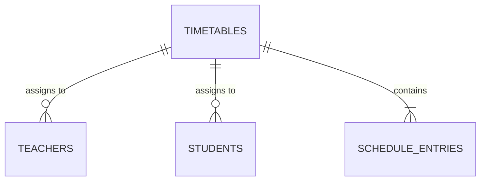

# College Project Report: CU Daily Schedule (Java Desktop Migration)

**Degree**: Bachelor of Technology in Computer Science & Engineering (CSE)  
**Course**: Advanced Java / Software Engineering / Database Systems  
**Project Title**: CU Daily Schedule — Smart Campus Timetable Desktop Application  

---

## 1. Introduction

### 1.1 Project Overview
**CU Daily Schedule** is an enterprise-grade desktop timetable management application developed in **Java Swing** and **JDBC** for Chandigarh University (CU). The application serves students and faculty members by providing automated, real-time schedule tracking, active lecture countdowns, classroom allocation details, and timetable administrative controls.

### 1.2 Objectives
1. Migrate an existing web-based React/Next.js timetable interface to a pure Java Desktop application.
2. Maintain schema compatibility with an existing PostgreSQL database hosted on Supabase.
3. Demonstrate core Advanced Java concepts:
   - Object-Oriented Programming (encapsulation, abstraction, inheritance, polymorphism).
   - Java Collections Framework (`List`, `Map`, `Set`, `Comparator`).
   - Exception Handling with customized error diagnostics.
   - Database Connectivity (JDBC) using `PreparedStatement` and connection pooling/transactions.
   - Multithreaded GUI processing using `SwingWorker` and Event Dispatch Thread (EDT) safety.
   - Modern, aesthetic Swing GUI styling adhering to Chandigarh University brand guidelines.

---

## 2. System Architecture

### 2.1 Layered Architecture
The system follows a strict 4-tier layered architecture:

```
+-------------------------------------------------------------------+
|                           Swing UI Layer                          |
|  (LandingScreen, StudentScheduleScreen, TeacherScheduleScreen,     |
|   AdminScheduleDialog, CircularProgressIndicator, UITheme)        |
+-------------------------------------------------------------------+
                                  │
                                  ▼
+-------------------------------------------------------------------+
|                           Service Layer                           |
|  (ScheduleTimingService, StudentService, TeacherService,           |
|   AdminScheduleService, DatabaseService)                          |
+-------------------------------------------------------------------+
                                  │
                                  ▼
+-------------------------------------------------------------------+
|                             DAO Layer                             |
|  (TimetableDAO, TeacherDAO, StudentDAO, ScheduleEntryDAO)         |
+-------------------------------------------------------------------+
                                  │
                                  ▼
+-------------------------------------------------------------------+
|                        JDBC & Database Layer                      |
|  (DBConnection, DBConfig, PostgreSQL JDBC Driver 42.7.3)          |
|  Supabase PostgreSQL (tables: timetables, teachers,               |
|                       students, schedule_entries)                 |
+-------------------------------------------------------------------+
```

---

## 3. Advanced Java Concepts Demonstrated

### 3.1 Object-Oriented Programming (OOP)
- **Encapsulation**: All entity models (`Timetable`, `Teacher`, `Student`, `ScheduleEntry`, `ClassSession`) maintain private member variables with accessor and mutator methods.
- **Separation of Concerns**: Separation between presentation (`ui`), business calculation (`service`), persistence (`dao`), and infrastructure (`config`).

### 3.2 Java Collections Framework
- `List<ScheduleEntry>` and `List<ClassSession>` for chronological class sequences.
- `Map<String, String>` in `SubjectRegistry` for rapid O(1) course code resolution.
- `Comparator.comparing(...)` lambda expressions for chronological timeline sorting.

### 3.3 Multithreading & Event Dispatch Thread (EDT)
- Swing GUIs operate on a single thread (EDT). Long-running database operations or network calls can cause UI freeze.
- `SwingWorker<T, V>` is used in `AdminScheduleDialog`, `DatabaseService`, and screen data loaders to execute database operations in background worker threads while publishing results back to the EDT.
- `javax.swing.Timer` delivers lightweight periodic tick events for countdown meters without thread thrashing.

### 3.4 JDBC & Transaction Management
- Parameterized SQL execution via `java.sql.PreparedStatement` preventing SQL injection vulnerabilities.
- Safe resource closing using Java 7+ try-with-resources.
- Multi-row batch inserts wrapped in explicit transactions (`conn.setAutoCommit(false)`, `stmt.executeBatch()`, `conn.commit()`, `conn.rollback()`).

---

## 4. Database Design & Schema

### 4.1 Schema Tables
1. **`timetables`**: Master timetable entity.
2. **`teachers`**: Faculty entity linked via foreign key `timetable_id`.
3. **`students`**: Student entity linked via foreign key `timetable_id`.
4. **`schedule_entries`**: Lecture / Lab / Tutorial slot linked via foreign key `timetable_id`.

### 4.2 Entity-Relationship Diagram


---

## 5. Screen Layouts & User Workflows

1. **Landing Screen**:
   - CU Logo, watermark background, title "DAILY SCHEDULE - SMART TIMETABLE DEVICE".
   - Two large interactive cards: "TAP YOUR NFC CARD" (Student) and "SCAN TEACHER QR CODE" (Teacher).
   - "DEVICE READY" status footer.

2. **Student Timetable Screen**:
   - Day & Date header.
   - Chronological timeline with time bounds, status dots (active ring, completed check, upcoming circle).
   - Class Details Panel: Large subject title, faculty, classroom badge, and live circular countdown ring.
   - Weekend empty state ("🎉 No Classes Today!") and End-of-day state ("🎉 Classes are Over!").
   - "View Tomorrow's Schedule" preview toggle.

3. **Teacher Search & QR Screen**:
   - Form for Employee ID input with uppercase normalization.
   - Simulated QR badge scanner dialog.
   - Quick selection buttons for faculty profiles (`E19761 - Neeraj`, `E16525 - Gitanjali`, `E10279 - Jaspreet`).

4. **Teacher Schedule Screen**:
   - Profile Header: Circular avatar initial, teacher name, department, Assistant Professor.
   - Dynamic Countdown Widget ("CLASS ENDS IN" or "NEXT CLASS IN").
   - Timeline of daily lectures with classroom, group, section tags.
   - Sticky Dynamic Panel with current lecture specifications.

5. **PostgreSQL CRUD Administration Dialog**:
   - Interactive `JTable` listing entries.
   - Forms to add, update, and delete schedule records.
   - One-click database connection latency test.

---

## 6. Testing & Results

- **Unit Tests**: 18 automated JUnit 5 tests covering configuration, timezone calculations, status detection, subject registry mapping, and DAO validation.
- **Build Status**: Maven compilation and packaging succeeded with shaded executable fat JAR generated: `target/cu-daily-schedule-java-1.0.0.jar`.

---

## 7. Conclusion

The migration successfully replicates all capabilities of the React application in a high-performance Java Swing desktop environment. Both applications share identical database schemas and can run independently without breaking existing database constraints or production data.
