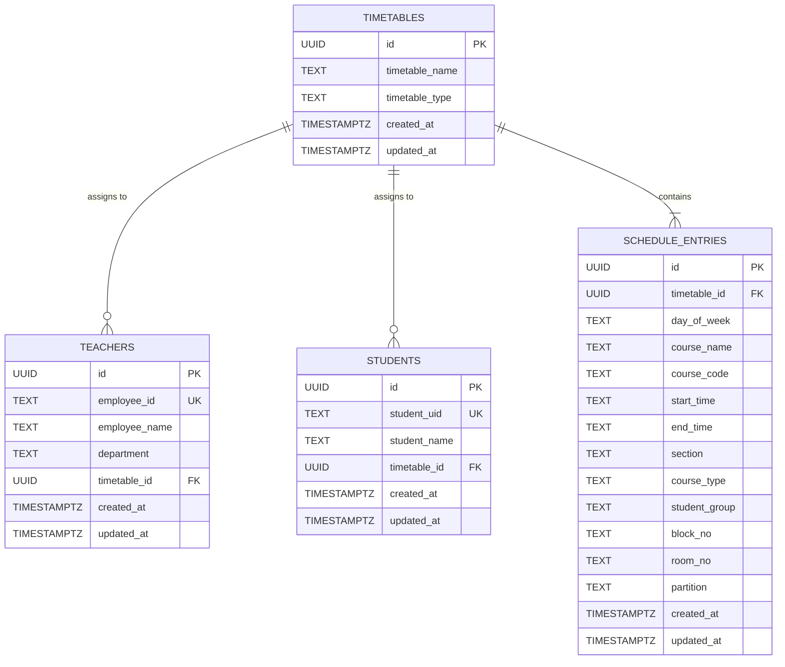

# Database Mapping: Supabase PostgreSQL to Java JDBC Models

This document defines the schema, table structures, column mappings, data types, primary keys, foreign keys, and corresponding Java Model classes for the CU Daily Schedule application.

---

## 1. Entity-Relationship Overview



---

## 2. Table-by-Table Mapping Specifications

### 2.1 Table: `timetables`
- **Purpose**: Represents the master timetable entity linked either to a teacher or a student group.
- **PostgreSQL Definition**:
  ```sql
  CREATE TABLE timetables (
      id UUID PRIMARY KEY DEFAULT gen_random_uuid(),
      timetable_name TEXT NOT NULL,
      timetable_type TEXT NOT NULL CHECK (timetable_type IN ('student', 'teacher')),
      created_at TIMESTAMPTZ NOT NULL DEFAULT NOW(),
      updated_at TIMESTAMPTZ NOT NULL DEFAULT NOW()
  );
  ```

| PostgreSQL Column | SQL Data Type | Constraints | Java Field | Java Data Type | Notes |
|---|---|---|---|---|---|
| `id` | UUID | PRIMARY KEY | `id` | `java.util.UUID` | Generated via `gen_random_uuid()` or Java `UUID.randomUUID()` |
| `timetable_name` | TEXT | NOT NULL | `timetableName` | `String` | e.g. `'Neeraj_Timetable'`, `'CSE_3rd_Year'` |
| `timetable_type` | TEXT | NOT NULL, CHECK ('student', 'teacher') | `timetableType` | `String` or `TimetableType` Enum | Restricts type to `'student'` or `'teacher'` |
| `created_at` | TIMESTAMPTZ | NOT NULL, DEFAULT NOW() | `createdAt` | `java.time.OffsetDateTime` | Auditing timestamp |
| `updated_at` | TIMESTAMPTZ | NOT NULL, DEFAULT NOW() | `updatedAt` | `java.time.OffsetDateTime` | Auto-updated via DB trigger `update_timetables_modtime` |

- **Java Model Class**: `com.cudailyschedule.model.Timetable`

---

### 2.2 Table: `teachers`
- **Purpose**: Stores faculty profiles and references their assigned timetable.
- **PostgreSQL Definition**:
  ```sql
  CREATE TABLE teachers (
      id UUID PRIMARY KEY DEFAULT gen_random_uuid(),
      employee_id TEXT NOT NULL UNIQUE,
      employee_name TEXT NOT NULL,
      department TEXT,
      timetable_id UUID REFERENCES timetables(id) ON DELETE SET NULL,
      created_at TIMESTAMPTZ NOT NULL DEFAULT NOW(),
      updated_at TIMESTAMPTZ NOT NULL DEFAULT NOW()
  );
  ```

| PostgreSQL Column | SQL Data Type | Constraints | Java Field | Java Data Type | Notes |
|---|---|---|---|---|---|
| `id` | UUID | PRIMARY KEY | `id` | `java.util.UUID` | Unique record ID |
| `employee_id` | TEXT | NOT NULL, UNIQUE | `employeeId` | `String` | e.g. `'E19761'`, `'E16525'`, `'E10279'` |
| `employee_name` | TEXT | NOT NULL | `employeeName` | `String` | Faculty full name (e.g. `'Neeraj'`, `'Gitanjali'`) |
| `department` | TEXT | NULLABLE | `department` | `String` | Department name (e.g. `'CSE'`) |
| `timetable_id` | UUID | FK -> `timetables(id)` ON DELETE SET NULL | `timetableId` | `java.util.UUID` | Reference to teacher's schedule |
| `created_at` | TIMESTAMPTZ | NOT NULL, DEFAULT NOW() | `createdAt` | `java.time.OffsetDateTime` | Record creation time |
| `updated_at` | TIMESTAMPTZ | NOT NULL, DEFAULT NOW() | `updatedAt` | `java.time.OffsetDateTime` | Record modification time |

- **Java Model Class**: `com.cudailyschedule.model.Teacher`

---

### 2.3 Table: `students`
- **Purpose**: Stores student profiles and links them to their cohort timetable.
- **PostgreSQL Definition**:
  ```sql
  CREATE TABLE students (
      id UUID PRIMARY KEY DEFAULT gen_random_uuid(),
      student_uid TEXT NOT NULL UNIQUE,
      student_name TEXT NOT NULL,
      timetable_id UUID REFERENCES timetables(id) ON DELETE SET NULL,
      created_at TIMESTAMPTZ NOT NULL DEFAULT NOW(),
      updated_at TIMESTAMPTZ NOT NULL DEFAULT NOW()
  );
  ```

| PostgreSQL Column | SQL Data Type | Constraints | Java Field | Java Data Type | Notes |
|---|---|---|---|---|---|
| `id` | UUID | PRIMARY KEY | `id` | `java.util.UUID` | Unique record ID |
| `student_uid` | TEXT | NOT NULL, UNIQUE | `studentUid` | `String` | University roll number or UID (e.g. `'24BCS-101'`) |
| `student_name` | TEXT | NOT NULL | `studentName` | `String` | Student full name |
| `timetable_id` | UUID | FK -> `timetables(id)` ON DELETE SET NULL | `timetableId` | `java.util.UUID` | Reference to student's cohort timetable |
| `created_at` | TIMESTAMPTZ | NOT NULL, DEFAULT NOW() | `createdAt` | `java.time.OffsetDateTime` | Record creation time |
| `updated_at` | TIMESTAMPTZ | NOT NULL, DEFAULT NOW() | `updatedAt` | `java.time.OffsetDateTime` | Record modification time |

- **Java Model Class**: `com.cudailyschedule.model.Student`

---

### 2.4 Table: `schedule_entries`
- **Purpose**: Stores individual class/session slots for a timetable.
- **PostgreSQL Definition**:
  ```sql
  CREATE TABLE schedule_entries (
      id UUID PRIMARY KEY DEFAULT gen_random_uuid(),
      timetable_id UUID NOT NULL REFERENCES timetables(id) ON DELETE CASCADE,
      day_of_week TEXT NOT NULL,
      course_name TEXT,
      course_code TEXT,
      start_time TEXT NOT NULL,
      end_time TEXT NOT NULL,
      section TEXT,
      course_type TEXT,
      student_group TEXT,
      block_no TEXT,
      room_no TEXT,
      partition TEXT,
      created_at TIMESTAMPTZ NOT NULL DEFAULT NOW(),
      updated_at TIMESTAMPTZ NOT NULL DEFAULT NOW()
  );
  ```

| PostgreSQL Column | SQL Data Type | Constraints | Java Field | Java Data Type | Notes |
|---|---|---|---|---|---|
| `id` | UUID | PRIMARY KEY | `id` | `java.util.UUID` | Unique slot ID |
| `timetable_id` | UUID | NOT NULL, FK -> `timetables(id)` ON DELETE CASCADE | `timetableId` | `java.util.UUID` | Parent timetable |
| `day_of_week` | TEXT | NOT NULL | `dayOfWeek` | `String` | e.g. `'Monday'`, `'Tuesday'`, `'Wednesday'`, `'Thursday'`, `'Friday'`, `'Saturday'` |
| `course_name` | TEXT | NULLABLE | `courseName` | `String` | e.g. `'Competitive Coding-II'` |
| `course_code` | TEXT | NULLABLE | `courseCode` | `String` | e.g. `'24CSP-305'` |
| `start_time` | TEXT | NOT NULL | `startTime` | `String` | Format: `'hh:mm a'` (e.g. `'09:30 AM'`) |
| `end_time` | TEXT | NOT NULL | `endTime` | `String` | Format: `'hh:mm a'` (e.g. `'10:20 AM'`) |
| `section` | TEXT | NULLABLE | `section` | `String` | e.g. `'24BCS_TPP-610'`, `'26ADS-513'` |
| `course_type` | TEXT | NULLABLE | `courseType` | `String` | e.g. `'Lecture'`, `'Tutorial'`, `'Practical'` |
| `student_group` | TEXT | NULLABLE | `studentGroup` | `String` | e.g. `'A'`, `'B'`, `'All'`, `'empty'` |
| `block_no` | TEXT | NULLABLE | `blockNo` | `String` | e.g. `'Block-B1'`, `'Block-C3'` |
| `room_no` | TEXT | NULLABLE | `roomNo` | `String` | e.g. `'407'`, `'613'`, `'511'` |
| `partition` | TEXT | NULLABLE | `partition` | `String` | e.g. `'A'`, `'B'`, `'empty'` |
| `created_at` | TIMESTAMPTZ | NOT NULL, DEFAULT NOW() | `createdAt` | `java.time.OffsetDateTime` | Record creation time |
| `updated_at` | TIMESTAMPTZ | NOT NULL, DEFAULT NOW() | `updatedAt` | `java.time.OffsetDateTime` | Record modification time |

- **Java Model Class**: `com.cudailyschedule.model.ScheduleEntry`

---

## 3. Database Triggers & Business Rules

1. **Trigger `update_modified_column()`**:
   Every table (`timetables`, `teachers`, `students`, `schedule_entries`) has an attached trigger function that updates `updated_at = NOW()` on every `UPDATE` statement.
2. **Referential Integrity**:
   - `schedule_entries` has `ON DELETE CASCADE` linked to `timetables(id)`. Deleting a timetable cleanly removes all its schedule entries.
   - `teachers` and `students` have `ON DELETE SET NULL` linked to `timetables(id)`. Deleting a timetable unlinks the user without deleting their identity record.
3. **Format Consistency**:
   - Time columns (`start_time`, `end_time`) are stored as `TEXT` in format `"hh:mm a"` (e.g. `"09:30 AM"`).
   - Java uses `java.time.format.DateTimeFormatter.ofPattern("hh:mm a", Locale.ENGLISH)` to parse and perform numerical comparisons and countdown calculations.
